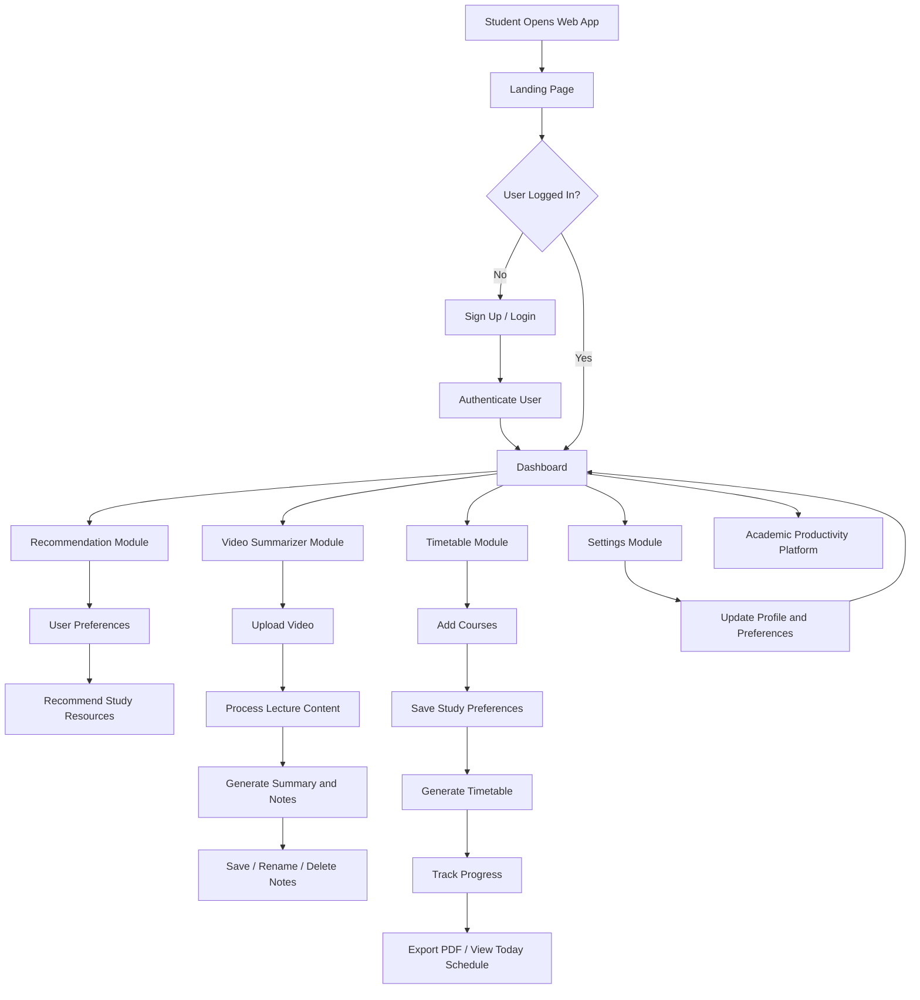
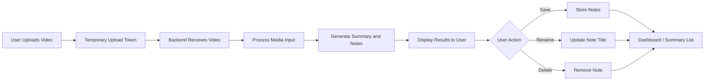
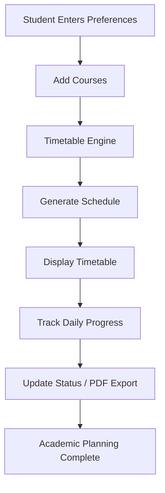

<p align="center">
  
</p>

# VidCloner Smart Assistant

A Django-based Final Year Project designed to improve student productivity, organization, and personalized learning support through a unified web application. The system integrates user authentication, academic recommendations, lecture summarization, timetable planning, and progress tracking into a single platform.

## Overview

This project aims to provide students with a digital academic assistant that helps them:

- manage study routines efficiently
- access relevant learning recommendations
- summarize uploaded educational videos
- generate academic timetables
- monitor study progress over time

The platform is implemented as a modular Django web application with separate components for each core feature area.

## Objectives

- Simplify academic planning and scheduling for students
- Improve access to learning resources through recommendations
- Support revision by generating summaries from lecture videos
- Provide an intuitive dashboard for day-to-day academic tracking
- Build a scalable foundation for future AI-based education features

## Key Features

### User Management and Dashboard
- Landing page and onboarding flow
- User signup and login
- Email-based authentication support
- Profile and dashboard integration
- Logout and session management

### Recommendation System
- Personalized learning suggestions
- Study-resource recommendation endpoints
- Foundation for future recommendation engine enhancements

### Video Summarization
- Video upload and streaming support
- Temporary token handling for uploads
- Lecture summary generation
- Save, rename, and delete notes
- Retrieval of saved summaries and titles

### Timetable Generation
- Save student study preferences
- Add course information
- Generate study timetable automatically
- Export timetable as PDF
- Track daily study progress
- View today’s timetable and update assignment status

### Settings and Preferences
- User preference management
- Application settings configuration
- Profile-related customization support

## Technology Stack

- Python
- Django
- SQLite (default development database)
- HTML, CSS, JavaScript
- Pandas, NumPy, Matplotlib

## Project Structure

```text
FYPproject(update-final)/
├── .gitignore
├── README.md
├── djangofyp/
│   ├── manage.py
│   ├── requirements.txt
│   ├── db.sqlite3
│   ├── model.txt
│   ├── APIs/
│   ├── djangofyp/
│   │   ├── __init__.py
│   │   ├── settings.py
│   │   ├── urls.py
│   │   ├── views.py
│   │   ├── asgi.py
│   │   └── wsgi.py
│   ├── landing_page_module/
│   ├── recommender_module/
│   ├── setting_module/
│   ├── time_table_module/
│   ├── video_summerizer_module/
│   ├── static/
│   │   └── assets/
│   └── templates/
├── media/
└── templates/
```

## Module Breakdown

### Landing Page Module
Responsible for the public landing experience, authentication pages, and user dashboard navigation.

### Recommender Module
Handles learning recommendations and study-related suggestions for users.

### Video Summarizer Module
Provides the platform’s summarization functionality for lecture and educational video content.

### Timetable Module
Generates a structured study timetable and provides academic progress analytics.

### Setting Module
Manages user settings and preference configuration across the system.

## System Flowchart



## Video Summarizer Workflow



## Timetable Generation Workflow



## Setup and Installation

### Prerequisites

- Python 3.9+ recommended
- pip
- Virtual environment support

### 1. Clone or open the project

```bash
cd FYPproject(update-final)
```

### 2. Create a virtual environment

```bash
cd djangofyp
python -m venv .venv
.venv\Scripts\activate
```

### 3. Install dependencies

```bash
python -m pip install --upgrade pip
python -m pip install -r requirements.txt
```

### 4. Apply database migrations

```bash
python manage.py migrate
```

### 5. Run the development server

```bash
python manage.py runserver
```

### 6. Access the application

Open the following URL in your browser:

```text
http://127.0.0.1:8000/
```

## Environment Configuration

The Django project loads environment-based configuration using a `.env` file. If required, create a `.env` file inside the `djangofyp` directory with values such as:

```env
SECRET_KEY=your-secret-key
DEBUG=True
```

> For production deployment, sensitive settings such as the secret key and email credentials should be moved to secure environment variables and not committed directly to the repository.

## Usage Workflow

1. Register or log in to the system.
2. Navigate through the dashboard and settings.
3. Use the recommendation module to discover relevant learning materials.
4. Upload or process educational video content in the summarizer module.
5. Generate a study timetable based on preferences and course data.
6. Monitor progress using the timetable and dashboard tools.

## Future Enhancements

- Improve recommendation accuracy using user behavior and preferences
- Integrate advanced AI models for more accurate lecture summarization
- Add role-based access for students, supervisors, and administrators
- Expand analytics and academic forecasting features
- Improve deployment readiness with production-grade security settings

## License

This project is intended for academic and final-year project use. Please confirm the licensing requirements before external publication or commercial redistribution.

## Project Status

The application is structured as a functional Django-based academic support platform and is suitable for continued development, enhancement, and academic presentation.

## Notes

This README reflects the current structure and functionality of the project and should be updated as the application evolves with new features or deployment requirements.
